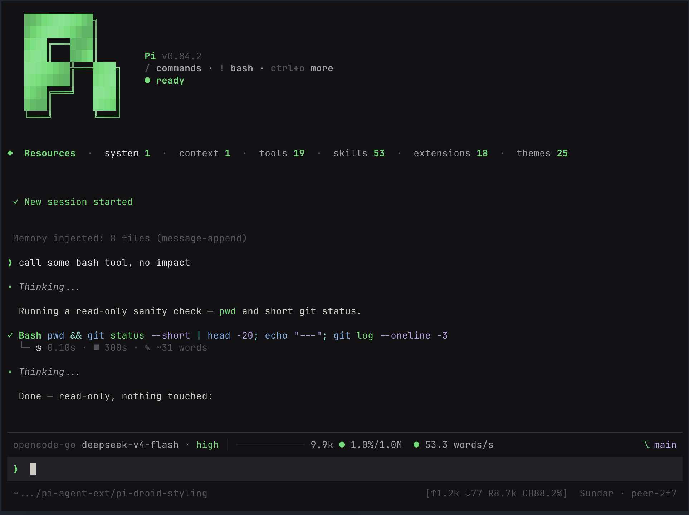

# pi-droid-styling

Opinionated Pi UI styling extension: compact startup UI, boxed editor, cleaner tool tags, message prefixes, footer stats, and reload-safe render patches.

## Screenshot



## Install

```sh
pi install npm:@sting8k/pi-droid-styling
```

Or install directly from Git:

```sh
pi install git:github.com/sting8k/pi-droid-styling
```

Requires Pi 1.x (`@earendil-works/pi-coding-agent` and `pi-tui` `>=1.0.0 <2.0.0`). Pi 0.x is not supported; use version 2.18.x or earlier there.

## Themes

This extension uses [`pi-themes`](https://github.com/sting8k/pi-themes) as its color layer. Installing `pi-droid-styling` automatically installs and registers those themes—no second install command is needed.

Already have `pi-themes` installed separately? Keep it. Existing themes take priority, and `pi-droid-styling` adds only the bundled themes that are missing—without duplicate-theme conflicts.

To install only the theme collection without this styling extension:

```sh
pi install git:github.com/sting8k/pi-themes
```

## Features

### Look and feel

- **A cleaner Pi, instantly.** Compact startup, a focused input editor, tidier conversations, collapsed tool output that still peeks at the live thinking tail, and a footer that tracks your session.
- **Paste screenshots as attachments.** Images pasted from the clipboard drop a `[Image #1]` token at the cursor instead of a raw `/tmp` path. The token is plain text: one Backspace deletes the whole token (atomic, like Claude Code chips), arrows and history work exactly as before, and you can move or copy the reference anywhere in the prompt. In conversation history the token is a clickable link (Cmd+Click) to a persistent copy, so the image survives session restarts. Submit resolves the tokens and sends real image content when the model supports it.
- **Make it yours.** Two conversation layouts, three prompt styles, multiple input frames, and 25 themes included.

### Built for the terminal

- **Smoother while the model works.** Streaming text and fast tool updates are batched into steady frames instead of repainting on every token.
- **Stays aligned when you resize.** Boxes, labels, and right-aligned status account for terminal escape codes, so they wrap and truncate cleanly.
- **Long sessions stay fast.** Only the newest part of the chat is rendered, while huge tool results are capped so history does not slow you down.
- **Reloads stay clean.** UI patches are applied once and removed cleanly, so extension reloads and session switches do not stack layout changes.

## Config

Config is stored at `~/.pi/agent/pi-droid-styling.json`:

```json
{
  "alwaysExpanded": false,
  "maxExpandedLines": 50,
  "dimToolOutput": false,
  "customWorkingMessage": {
    "working": "Working",
    "thinking": "Thinking",
    "answering": "Answering",
    "running": "Cooking"
  },
  "presentationStyle": "droid",
  "userZoneStyle": "gemini",
  "inputBox": {
    "style": "auto"
  },
  "tasksWidgetStyle": "compact",
  "collapsedThinking": "tail",
  "diffMode": "auto",
  "forceOSC11": false,
  "transparentBackground": false,
  "visibleChatTail": 30,
  "imageAttachments": true
}
```

| Setting | Options | Default | What it does |
| --- | --- | --- | --- |
| `alwaysExpanded` | `true`, `false` | `false` | Open tool output by default. `Ctrl+O` still toggles it. |
| `maxExpandedLines` | `0`–`1000` | `50` | Limit expanded tool output. Use `0` for no limit. |
| `dimToolOutput` | `true`, `false` | `false` | Dim tool output so the conversation stands out. |
| `customWorkingMessage` | Custom text | See example | Rename the working, thinking, answering, and tool-running labels. You can set only the ones you want to change. |
| `presentationStyle` | `droid`, `reasonix`, `claudecode` | `droid` | `droid` keeps cards and tool boxes. `reasonix` uses a cleaner, compact conversation layout. `claudecode` uses the same layout with Claude Code-style tool calls: `● Read(src/a.ts)` on one row (long arguments end in `…`) and the result on a `└` line below. Assistant turns always start with `●` (the theme's `assistantPrefix` is ignored). Hidden thinking reads `● thinking` while live and `● thought` once done. Two or more consecutive tool calls fold under one `● Running(…)` / `● Done(3 tool calls · 1 thought)` row with each call listed as a smaller `•` row in a `├─` / `└─` tree; `Ctrl+O` shows full output. |
| `userZoneStyle` | `gemini`, `droid`, `cli-dock`, `nvim` | `gemini` | Choose the look of the prompt, status rows, and footer. `nvim` is a Neovim-style dock: a lined input plus one statusline bar (thinking-level badge, model, branch, tokens, context %, cache-hit %). |
| `inputBox.style` | `auto`, `halfblock`, `line`, `solid` | `auto` | Choose the input-box frame. `auto` uses the best match for the selected user-zone style. Some presets always resolve to a frame outside this list regardless of the setting: `cli-dock` always renders `outline`, and `droid` collapses an explicit `line` to `none`. |
| `tasksWidgetStyle` | `compact`, `default` | `compact` | Use the one-line tasks widget, or leave the original `pi-tasks` widget unchanged. |
| `collapsedThinking` | `tail`, `label` | `tail` | While thinking is hidden (`Ctrl+T`), each collapsed thinking row shows the end of the thinking text with a `▸` live marker (`·` once the run is done). `label` restores the static label. |
| `diffMode` | `auto`, `split`, `unified` | `auto` | Diff layout for `edit`/quick-edit results. `split` is the side-by-side view; `unified` is a single-column stacked diff (same palette, syntax highlighting, and word-level emphasis); `auto` uses split when the terminal is at least 140 columns wide and falls back to unified below that. Disjoint hunks are separated by a `··· N unmodified lines ···` marker, and removed/added line pairs that barely resemble each other are treated as full rewrites (no word-level emphasis). |
| `forceOSC11` | `true`, `false` | `false` | Force terminal background sync on Windows/WSL. Usually leave this off. |
| `transparentBackground` | `true`, `false` | `false` | Stop painting the page/frame background, tool boxes, user messages, and the input box, and reset OSC 11, so the terminal's own background (wallpaper, blur) shows through. Selections and diff accents stay opaque. Dim/blur is tuned on the terminal side (Ghostty `background-image`, kitty `background_image`, WezTerm `window_background_image`). |
| `visibleChatTail` | `0` or more | `30` | Render only the newest N chat items for speed. Use `0` to render everything. |
| `imageAttachments` | `true`, `false` | `true` | Paste clipboard images as `[Image #N]` text tokens at the cursor (Backspace deletes like any text; ids are monotonic per project and never reused). Pasted bytes are persisted immediately into the session directory for the current project (`~/.pi/agent/sessions/--<cwd>--/images/<N>.<ext>` — images share the sessions' lifecycle; the host tmp file is consumed), so restart/resume in the same project restores both the OSC 8 history links and the newest 16 re-sendable references from disk. The startup sweep deletes store files older than 7 days; resuming somewhere the files no longer exist degrades old tokens to literal text (the model context itself keeps its embedded copies). Submit keeps tokens in the sent text and sends real image content when the model accepts image input, otherwise tokens are replaced inline by their file paths. `false` restores the stock host behavior of inserting the path into the text. |

Streamed answers appear character by character, with the newest characters fading in on truecolor themes. Finished and resumed messages always show at once. Set `PI_REDUCED_MOTION=1` to show streamed text in chunks instead.

## Profiling

Render profiling is disabled by default. To capture render/update/git metrics plus memory, CPU delta, and event-loop utilization:

```sh
PI_DROID_PROFILE=1 PI_DROID_PROFILE_OUT=/tmp/pi-droid-profile.jsonl pi
```

Useful environment variables:

- `PI_DROID_PROFILE=1` enables profiling.
- `PI_DROID_PROFILE_OUT=/path/profile.jsonl` writes JSONL output. Use `stderr` or `stdout` for stream output.
- `PI_DROID_PROFILE_INTERVAL_MS=5000` controls summary cadence.

Synthetic self-check:

```sh
npm run profile:render
```

The synthetic bench exercises footer/editor rendering, render throttle, assistant/tool debounce, and git status refresh. Runtime terminal paint/GPU cost still needs a real Pi TUI capture.

## Notes

- Works with the active Pi theme; it paints TUI cells explicitly and uses OSC 11 terminal background sync on non-Windows hosts to cover terminal-owned padding/remainder areas. Windows/WSL/Windows Terminal skip OSC 11 unless `forceOSC11` is enabled.
- `transparentBackground: true` skips page/frame background painting, tool boxes, boxed core message blocks, user-message backgrounds, and input-box bg fills (all presets), and resets OSC 11 so the terminal's own default background (wallpaper, blur) shows through. Real selections and diff accents stay opaque for readability; half-block ▄▀ frame edges blank out to plain rows (row count and width preserved), so only `outline`/`line` frames keep a visible edge.

- `customWorkingMessage` is on by default. Set `working`, `thinking`, `answering`, and `running` strings to customize the themed loader labels.
- Attachments are text tokens (`[Image #1]`), the same model Claude Code uses: Backspace deletes the reference, `↑`/`↓` history is never hijacked, and moving/copying the token changes where the image is referenced. Numbers are assigned at paste time and never renumbered — `[Image #1] [Image #3]` after deleting #2 is valid. On submit, tokens stay in the sent text (the Claude Code / Codex convention), so the conversation, input history, and the model all keep the same positional reference; text-only models get tokens replaced inline by their file paths. Submissions do not consume the registry: tokens recalled from input history still resolve and can re-send the same image without re-pasting (Codex local-history semantics) — the registry keeps the newest 16 attachments and FIFO-evicts older ones (evicted tokens degrade to literal text). Submit itself stays with Pi (input history, queueing a message while the agent is busy); the images are attached through Pi's `input` event. Hand-typed or long-recalled tokens with no image behind them stay as literal text. Slash-command and `!` bash submits keep the host path.
- Existing legacy `customWorkingMessage: true` or `false` values are normalized back to the default label object.

## Credits

The gradient startup header was inspired by [EnderLiquid/pi-startup-header](https://github.com/EnderLiquid/pi-startup-header).

The `claudecode` presentation style (the `● Name(args)` tool rows and the folded `● Running(…)` / `● Done(…)` activity group) was modelled on the look of [ykn0309/pi-pretty-tui](https://github.com/ykn0309/pi-pretty-tui) by Kainan Yang (MIT); it is a re-implementation, not copied code.

## License

MIT
